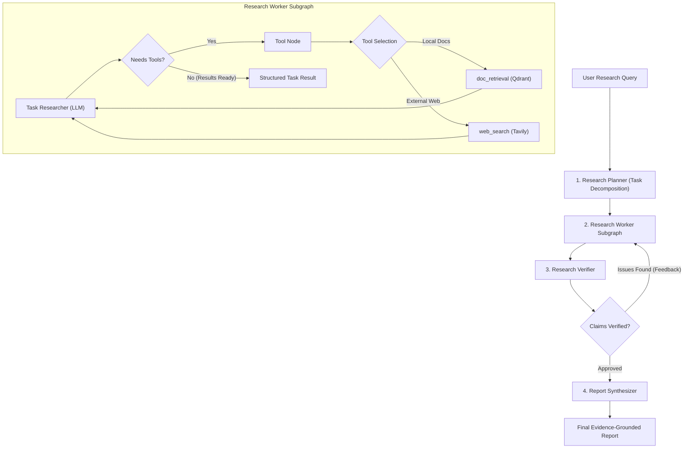

# 🚀 ResearchPilotAi

**ResearchPilotAi** is an autonomous, agentic research and retrieval-augmented generation (RAG) system built with **LangGraph**, **Qdrant**, and **Google Gemini**. It transforms complex research queries into actionable research plans, autonomously retrieves factual evidence from heterogeneous local documents and live web searches, verifies findings through a self-correcting feedback loop, and synthesizes evidence-grounded research reports.

---

## 📑 Table of Contents

- [Overview](#-overview)
- [Architecture & Workflow](#-architecture--workflow)
- [Key Features](#-key-features)
- [Project Structure](#-project-structure)
- [Supported Document Formats](#-supported-document-formats)
- [Setup & Installation](#-setup--installation)
- [Usage Guide](#-usage-guide)
  - [1. Ingesting Documents](#1-ingesting-documents)
  - [2. Running the Research Graph](#2-running-the-research-graph)
- [Observability](#-observability)

---

## 🔍 Overview

ResearchPilotAi is designed to solve common limitations in traditional RAG and LLM research:
1. **Multi-Source Hybrid Evidence**: Combines private local document retrieval with live web search (Tavily).
2. **Multi-Format Ingestion**: Ingests everything from PDFs and Word documents to CSV spreadsheets, HTML pages, presentations, and JSON datasets.
3. **Agentic Planning & Execution**: Deconstructs questions into sequential sub-tasks rather than performing a single shallow lookup.
4. **Self-Verification Loop**: Validates extracted claims against retrieved evidence, returning feedback for re-investigation before final synthesis.
5. **Rate-Limit Resilience**: Embedded exponential backoff handling ensures uninterrupted batch operations against API rate limits.

---

## 🧠 Architecture & Workflow

The core pipeline is orchestrated using a stateful **LangGraph** architecture:



1. **Research Planner (`research_planner.py`)**: Breaks the initial prompt down into ordered, atomic sub-tasks.
2. **Research Executor (`research_executer.py`)**: Executes each task using tools (`doc_retrieval` and `web_search`), gathering verifiable evidence.
3. **Verification Loop (`research_verification.py`)**: Reviews evidence, identifies unsupported statements, and triggers iterative refinement when needed.
4. **Report Synthesizer (`research_report.py`)**: Synthesizes verified findings into a cohesive, cited final report.

---

## ⚡ Key Features

- **Universal Document Ingestion**: Ingests `.pdf`, `.docx`, `.txt`, `.html`, `.json`, `.csv`, and `.pptx` files with custom metadata extraction.
- **Qdrant Vector Database**: High-performance semantic vector search with cosine distance and payload indexing for multi-tenant isolation (`user_id`, `chat_id`, `source`, `source_type`).
- **Citation-Ready Document Retrieval Tool (`doc_retrieval`)**:
  - Semantic similarity query matching with optional document filtering (`filename_filter`).
  - Returns formatted excerpts labeled with document names, relevance scores, pages, and chunk counts for direct LLM citation.
- **Smart Rate-Limit Backoff**: Automatic retry and dynamic sleep handling for Google Gemini Free Tier (`429 RESOURCE_EXHAUSTED`), eliminating batch failures.
- **Full Observability**: Integrated with **Pydantic Logfire** for tracing, spans, tool calls, and error tracking.

---

## 📂 Project Structure

```text
ResearchPilotAi/
├── ai/
│   ├── graph/                      # Agentic graph architecture
│   │   ├── models/                 # Pydantic schemas (TaskResults, VerificationResult)
│   │   ├── nodes/                  # Core graph nodes
│   │   │   ├── research_planner.py     # Deconstructs prompt into sub-tasks
│   │   │   ├── research_executer.py    # Executes individual research tasks
│   │   │   └── research_report.py      # Synthesizes final report
│   │   ├── subgraphs/              # Worker subgraphs with ToolNode execution loops
│   │   │   └── research_worker.py
│   │   ├── tools/                  # LLM tools
│   │   │   ├── doc_retrieval.py        # Local vector document retrieval
│   │   │   └── web_search.py           # Tavily web search integration
│   │   ├── config.py               # Model configurations and tool binding
│   │   ├── states.py               # LangGraph TypedDict states
│   │   ├── system_messages.py      # System prompts for planner, researcher, verifier
│   │   └── workflow.py             # Main compiled LangGraph pipeline
│   ├── retrieval/                  # Ingestion, chunking, and vector search
│   │   ├── loaders/                # Multi-format document parsers
│   │   │   ├── pdf_load.py             # PDF reader (pypdf)
│   │   │   ├── doc_txt_loader.py       # DOCX & plain text (docx2txt)
│   │   │   ├── bs4_load.py             # HTML scraper & parser (BeautifulSoup4)
│   │   │   ├── json_loader.py          # Recursive key-value JSON parser
│   │   │   ├── csc_loader.py           # Structured CSV row parser
│   │   │   └── ppt_loader.py           # PowerPoint parser (python-pptx)
│   │   ├── chunking.py             # Recursive character splitter
│   │   ├── embeddings.py           # Gemini embedding model with rate-limit retry
│   │   ├── processor.py            # Automated batch document ingestion into Qdrant
│   │   └── retriever.py            # Qdrant query & similarity search functions
│   └── observability.py            # Logfire telemetry setup
├── data/                           # Local documents (PDFs, Word docs, CSVs, etc.)
├── pyproject.toml                  # Project dependencies & build configuration
└── README.md
```

---

## 📄 Supported Document Formats

All loaders return unified `(text: str, metadata: dict)` tuples:

| Extension | Loader File | Parser / Library | Extracted Metadata |
|---|---|---|---|
| `.pdf` | `pdf_load.py` | `pypdf` | Pages count, title, author, subject, file size |
| `.docx`, `.doc` | `doc_txt_loader.py` | `docx2txt` | File size, character count |
| `.txt`, `.md` | `doc_txt_loader.py` | Python built-in | Line count, character count |
| `.html`, `.htm` | `bs4_load.py` | `BeautifulSoup4` | Page title, description meta, author, language |
| `.json` | `json_loader.py` | Built-in recursive parser | Structure type, element count, value count |
| `.csv` | `csc_loader.py` | Built-in `csv` reader | Row count, column count, column headers |
| `.pptx`, `.ppt` | `ppt_loader.py` | `python-pptx` | Total slides, extracted slides, character count |

---

## 🛠️ Setup & Installation

### 1. Prerequisites
- Python `>= 3.10`
- [uv](https://docs.astral.sh/uv/) (recommended) or `pip`

### 2. Clone and Install Dependencies
```bash
# Clone the repository
git clone https://github.com/himanshubinwal/ResearchPilotAi.git
cd ResearchPilotAi

# Sync dependencies using uv
uv sync
```

### 3. Environment Configuration
Create a `.env` file in the root directory:

```env
# Google Gemini API (LLM & Embeddings)
GEMINI_API_KEY=your_gemini_api_key

# Qdrant Cloud Vector Database
QDRANT_URL=https://your-cluster-url.qdrant.io:6333
QDRANT_API_KEY=your_qdrant_api_key

# Web Search
TAVILY_API_KEY=your_tavily_api_key

# Additional Providers (Optional)
GROQ_API_KEY=your_groq_api_key
OPENROUTER_API_KEY=your_openrouter_api_key

# Session Configuration
USER_ID=himanshu
CHAT_ID=chat_1
```

---

## 💻 Usage Guide

### 1. Ingesting Documents
Place your files (PDFs, DOCX, CSVs, TXT, PPTX, HTML, JSON) into the `data/` folder, then run the processor:

```bash
# Ingest all documents found in the data/ directory
uv run python -m ai.retrieval.processor

# Or ingest a specific document
uv run python -m ai.retrieval.processor data/resume.docx
```

The processor will automatically:
- Parse text and extract metadata for each format.
- Split content into semantic chunks using `RecursiveCharacterTextSplitter`.
- Generate 3072-dimension vectors with Gemini (`gemini-embedding-001`).
- Upsert vectors with full metadata into Qdrant (`VECTOR_3`).

### 2. Running the Research Graph
To run an end-to-end research query through the multi-agent workflow:

```bash
uv run python -m ai.graph.workflow
```

Or trigger specific research queries in code:
```python
from ai.graph.workflow import research_graph

input_state = {
    "query": "According to our uploaded documents, explain the stages of spoken word recognition.",
    "user_id": "himanshu",
    "chat_id": "chat_1",
}

for event in research_graph.stream(input_state):
    for node, output in event.items():
        print(f"--- Finished node: {node} ---")
```

---

## 📊 Observability

ResearchPilotAi uses **Logfire** for distributed tracing across all agents, tool calls, and embedding operations:

- View live traces of planning steps, sub-task delegations, and tool invocations.
- Monitor token usage, latency, and similarity search scores.
- Track retries and rate-limit backoff durations automatically.
